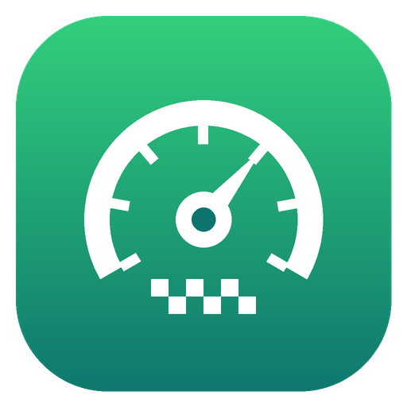

<p align="center">
  
</p>

<h1 align="center">Pitstop</h1>

<p align="center"><b>A clean NVIDIA driver manager for Windows.</b></p>

<p align="center">
  <a href="../../releases/latest"></a>
  
  
</p>

Pitstop replaces the NVIDIA App and GeForce Experience with one small window: see which driver you have, get the newest Game Ready or Studio driver straight from NVIDIA, install just the driver (no NVIDIA App, no telemetry), roll back in one click, and tune the game settings people actually change. It's in the spirit of NVCleanstall and NVIDIA Profile Inspector, but simple.

## Features

- **Your card and driver at a glance**: GPU, video memory, the installed driver version and whether it's Game Ready or Studio
- **Newest drivers from NVIDIA**: the latest Game Ready and Studio drivers for your card from NVIDIA's own driver lookup, with release date, size and a link to the release notes
- **Clean install**: downloads the official package from NVIDIA's servers only, checks NVIDIA's digital signature, unpacks only the parts you pick and installs them silently
  - Always the display driver; optionally PhysX, HD Audio and the USB-C driver
  - Never the NVIDIA App, GeForce Experience, NvContainer or telemetry
  - **Perform a clean install** resets every NVIDIA setting and profile
  - **Turn off NVIDIA telemetry tasks** disables any data-collection or update-check tasks that remain
- **Restore point first**: a Windows restore point before every install (on by default, can be turned off)
- **Plain-English progress**: each step (download, signature check, unpack, restore point, install) with a progress bar and what's happening right now
- **One-click rollback**: Pitstop keeps the last 3 drivers you installed (size shown, delete any of them) and reinstalls any one without downloading again. Saved packages are re-checked (SHA-256 and signature) before use
- **Game settings**: every game profile in the driver, searchable by name or .exe, plus the Global profile. Change the settings that matter: max frame rate, low latency mode, V-Sync, power management mode, texture filtering quality, shader cache size and G-SYNC. Export and import them as a file
- **Driver history**: every install and rollback with dates, versions and results
- **New-driver alerts (optional)**: from the tray, on a timer you choose. No background service
- **Admin only when needed**: Pitstop starts without admin rights and asks once, at the moment you install a driver or save game settings

## Install

Download `Pitstop.exe` from the [latest release](../../releases/latest) and run it. It's a single file with nothing to install. Or get it from [Hangar](https://github.com/larosa023/Hangar), which keeps the whole suite up to date.

Pitstop updates itself: it checks GitHub Releases when it opens and every few hours, downloads in the background, verifies the SHA-256, and switches over when you click **Update ready · Restart**. If the new version doesn't start, Pitstop puts the old one back on its own. Choose **Stable** or **Beta** in Settings.

**Portable mode:** put an empty file named `portable` next to `Pitstop.exe` and Pitstop keeps everything (settings, saved drivers, themes) in a `data` folder beside it instead of `%LocalAppData%\Pitstop`.

## Themes

The suite's 14 themes switch instantly: **Dark** (Mica, the default), **Light**, **Windows**, **Midnight**, **Glass**, **Frost**, **Twilight**, **Forest**, **Sunset**, **Ocean**, **Rose**, **Graphite**, **Paper** and **Mist**. The accent color can follow the theme, Windows, one of 9 swatches or any color you type.

Custom themes use [Hangar's format](https://github.com/larosa023/Hangar/blob/main/docs/THEMES.md). Pitstop reads them from its own themes folder (**Settings → Open folder**) and from Hangar's (`%LOCALAPPDATA%\Hangar\themes`), so a theme you make once works across the suite. **Save as file** writes the current theme as a starting point:

```json
{
  "schema": 1,
  "name": "My Theme",
  "mode": "dark",
  "backdrop": "mica",
  "transparency": 0.15,
  "colors": {
    "background": "#2E3440",
    "surface": "#3B4252",
    "text": "#ECEFF4",
    "accent": "#88C0D0"
  }
}
```

Any color you leave out comes from Dark or Light.

## How a clean install works

1. Pitstop asks NVIDIA's driver lookup (the one behind nvidia.com/drivers) for your card's drivers.
2. It downloads the package from `*.download.nvidia.com` over HTTPS. Any other address is refused.
3. Windows checks the package's Authenticode signature; it must be valid and signed by NVIDIA Corporation.
4. Pitstop reads the 7-Zip archive inside the package directly and unpacks only the display driver, NVIDIA's installer core and the extras you picked. It removes the references to the EULA, consent and privacy pages of the packages it left out from `setup.cfg`.
5. One admin prompt: a restore point, then NVIDIA's own `setup.exe` in silent mode (`-clean` for a clean install), then the telemetry tasks are turned off.
6. The original package is kept for rollback, and the install is logged in History.

## Shortcuts

| Keys | Does |
|---|---|
| `Ctrl+,` | Settings |
| `Ctrl+B` | Collapse the sidebar |
| `F5` | Check for new drivers |

## Build from source

Requirements: Windows 10/11 and the [.NET 10 SDK](https://dotnet.microsoft.com/download/dotnet/10.0).

```powershell
git clone https://github.com/larosa023/Pitstop
cd Pitstop
dotnet run --project src/Pitstop
```

Or open `Pitstop.sln` in Visual Studio 2022 or Rider. `Pitstop.exe --selftest <folder>` runs the same pipeline test CI runs (NVIDIA lookup, real download, signature check, unpack).

## Releasing a new version

1. Bump `<Version>` in `src/Pitstop/Pitstop.csproj` (for example `0.1.0` → `0.1.1`, or `0.2.0-beta.1` for a Beta).
2. Update `CHANGELOG-latest.md` (it becomes the release notes).
3. Commit and push to `main`.
4. The **Build** workflow builds `Pitstop.exe`, runs the smoke test and the self-test, and publishes a GitHub Release tagged `v0.1.1` with `Pitstop.exe` and `SHA256SUMS.txt`. Installed copies pick it up on their next check.

Pushes that don't change the version are built and tested but not released.

## Tech stack

| Piece | Used for |
|---|---|
| [.NET 10](https://dotnet.microsoft.com) + [Avalonia UI](https://avaloniaui.net) | Fast, GPU-rendered native UI; one self-contained, precompiled exe |
| NVIDIA NvAPI (`nvapi64.dll`, part of the driver) | GPU and driver info, game profiles (DRS) |
| [SharpCompress](https://github.com/adamhathcock/sharpcompress) | Reading the 7-Zip archive inside NVIDIA's package |
| [CommunityToolkit.Mvvm](https://github.com/CommunityToolkit/dotnet) | View-models without boilerplate |

## Project layout

```
src/Pitstop/
  Native/       NvApi (driver + profiles), WinTrust (signature checks)
  Models/       Settings, history, saved packages, elevated jobs, profile export
  Services/     Driver lookup, installer, extractor, package store, profiles, themes, updater, self-test
  ViewModels/   One per page
  Views/        One per page
  Styles/       Shared styles (cards, nav, pills)
```

## License

MIT. NVIDIA, GeForce, PhysX and G-SYNC are trademarks of NVIDIA Corporation. Pitstop isn't affiliated with NVIDIA; it downloads NVIDIA's unmodified driver packages from NVIDIA's servers.
